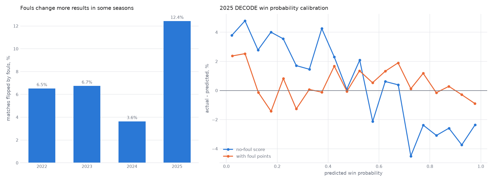

# Fouls

How the sim accounts for fouls: RPs awarded by fouls are inside the RP curves' probabilities, and foul
points are drawn for each alliance and added to its no-foul score to predict its official score.

## Foul-awarded RPs

A game rule can grant an alliance a bonus RP because of its opponent's foul. Each RP curve in the
[score and RP model doc](score-and-rp-model.md) is threshold-based, the chance the alliance's points clear the RP's
threshold, but is fitted by `fit_curve` in `sim/rp_probability.py` on whether the RP was awarded. Foul-awarded RPs are
in that fit, absorbed by the curve's shift, spread and cap. This is a known weakness, but allows the catch-all RP model
to stay generalizable.

## Foul points on the result

Foul points an alliance receives count toward its official score, which decides win, tie and loss, but not toward its
no-foul score, `preFoulTotal`, the first tiebreaker. The sim keeps the two apart:

- The no-foul score is the skewed-t model's draw, and it is `preFoulTotal`.
- The official score adds the foul points, drawn from a gamma with mean `ScoreModel.foul_mean` and variance
`ScoreModel.foul_variance`. A draw below `FOUL_STEP` counts as no foul, and the rest round to the nearest `FOUL_STEP`,
since real foul points come in discrete multiples.

The mean is the season's mean foul points received. It sets a more realistic official score but cancels out in terms of
win probability. The variance does change who wins.

All values use earlier seasons' values averaged until the season has `INIT_WINDOW` rows, then are
refit weekly. The measured values are in `MEASURED_SCORE_MODELS` in `sim/constants.py`.

## Results

Measured on epa-0.10.0, qualification rows, 2022 to 2025. Each season was simmed through `draw_matches` with
its whole-season models, with and without foul points, and scored on official results, a tie counted as half a win.

| Season | Foul points received, mean | Results fouls changed | Log loss, no-foul score | Log loss, with foul points | Calibration error, no-foul score | Calibration error, with foul points |
| --- | --- | --- | --- | --- | --- | --- |
| 2022 | 6.62 | 6.5% | 0.5303 | 0.5288 | 1.0 | 0.7 |
| 2023 | 5.56 | 6.7% | 0.5354 | 0.5322 | 1.4 | 0.7 |
| 2024 | 3.49 | 3.6% | 0.4996 | 0.4986 | 1.0 | 0.9 |
| 2025 | 15.06 | 12.4% | 0.5318 | 0.5270 | 2.4 | 0.8 |

Calibration error is in points of probability.

