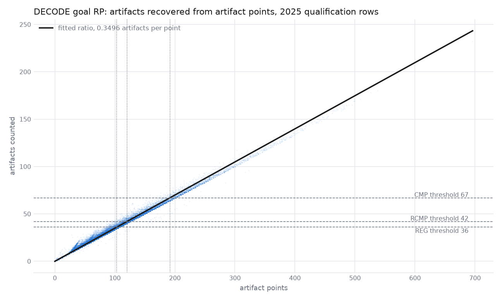

# Score and RP model

How a match is simulated: each alliance's no-foul score, its official result and its bonus RPs, are all drawn
together from one season's models. The models read predicted points from a predictor, refit weekly through the season.

## Predictor

A `Predictor` (`sim/predictor.py`) gives each past qualification alliance-row its rated teams' predicted points per
component, as they stood before the match. `EpaPredictor` reads them from an EPA.

## Models

### Score

`ScoreModel` (`sim/score.py`) is the [skewed-t model](score-distribution.md), on the alliance's predicted total.
It also carries `foul_variance`, the variance of a zero-mean normal added to each alliance's no-foul score to decide
the official result;

### Bonus RPs

`RpCurve` (`sim/rp_probability.py`) is the generic fallback model for an RP's probability, and it works from the
alliance's predicted points for that RP. Picture a normal curve centered on the predicted points, offset by a fitted
shift. Its spread widens or narrows exponentially as the predicted points go up. The RP's probability is the share of
that curve above the threshold, with the threshold lowered by half a point. That probability is then capped at the
earned rate of the highest probability bucket with enough rows.

An RP based on a count is estimated by a proxy from points. Its source (`sim/rp_source.py`) names the leaf components its points come
from and a recovery from points to the counted quantity:

| Recovery | Quantity from points `P` | Fitted | Used by |
| --- | --- | --- | --- |
| `Identity` | `P` | no | every point RP |
| `FloorDivide(d)` | whole multiples of `d` | no | BIOBUZZ pollinator RPs, hive tips from hive points |
| `Ratio()` | `P` times the season's count per point | yes | DECODE goal RP, artifacts from artifact points |
| `FromFunction(f)` | any non-decreasing `f(P)` | no | a custom formula |

The count threshold becomes the fewest points whose recovered quantity reaches it. An RP with no declared source takes
the identity on its rule-pack `sum_of`, which must then be all leaves.

Each curve also carries `correlation`, how closely earning the RP follows the alliance's score draw.

### Sampling matches

`draw_matches` (`sim/match.py`) gives each alliance one latent standard normal per match:

- The no-foul score is the score model's quantile at that draw, in whole points. It is also `preFoulTotal`.
- Each bonus RP is earned when its correlation times the draw, plus independent noise, clears the RP curve's
  probability, so each RP keeps its curve's rate and moves with the score. RPs on one source share the noise.
- Each tiebreaker component is a fixed share of the no-foul score: the season's total of that component over its total
  no-foul score.
- The official score adds the "foul" noise, and decides win, tie and loss.
- The two alliances are drawn independently.

## Fitting and cadence

`season_models` (`sim/fit.py`) fits a season's models on qualification rows from events that started before a cutoff.

| Below `INIT_WINDOW` rows | From `INIT_WINDOW` rows |
| --- | --- |
| Score model and result noise: earlier seasons' measured models averaged | Refit in full on only this season so far |
| RP curves and correlations: the stand-ins in `RP_STAND_INS`, averaged | Refit in full on only this season so far |

The measured constants are whole-season fits in `MEASURED_SCORE_MODELS` and `MEASURED_RP_CURVES` in
`sim/constants.py`, keyed by predictor version and season.

## Results

Measured on epa-0.10.0, qualification rows, 2022 to 2025.

### Count RPs recovered from points

DECODE's goal RP thresholds artifacts scored, not points. Artifacts could score 3 or 1 points, but usually 3.
A simple ratio could reasonably predict the count of scored artifacts.

| RP level | Count threshold | Points threshold | Median observed points at that count |
| --- | --- | --- | --- |
| REG | 36 | 103.0 | 104 |
| RCMP | 42 | 120.1 | 120 |
| CMP | 67 | 191.6 | 199 |

