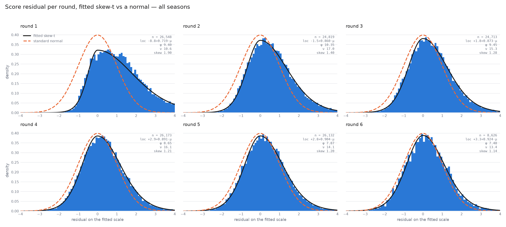
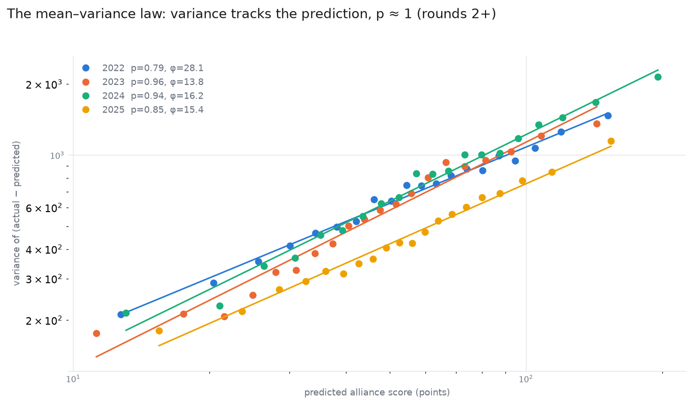
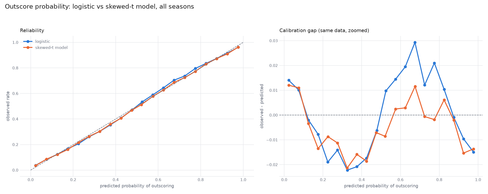

# Score distribution

How an alliance's no-foul score is spread around its predicted score.

## The family

An alliance's no-foul score `y`, given the summed EPA of its rated teams `mu`, follows a Fernandez-Steel skewed
Student-t:

```
y = a + c * mu + sqrt(phi * mu) * e
e ~ skewed t with nu degrees of freedom and skew g
```

The center of the distribution is a straight line in the prediction, `a + c * mu`, and its variance is proportional to
the prediction.

## Data

Qualification matches at Qualifier and League Meet events, 2022 to 2025, scored on live EPA: a team enters an event at
its pre-event rating, and each match's prediction reads only ratings written before it. Alliances predicted at or below
5 points were ignored.

A row's round is its teams' qualification match number at the event. A row whose teams have played different numbers
of matches belongs to no round, and counts only in the pooled fits.

## Findings

### The skewed-t model fits every round

Fitted per round, the skewed-t model follows the residual histogram where a normal of the same scale does not. Round
one is the most skewed and the least well predicted, since teams enter on carried-over ratings; from round two the
shape settles and changes slowly.



| Round | Location | phi | nu | Skew |
| --- | --- | --- | --- | --- |
| 1 | -8.8 + 0.719 mu | 9.40 | 10.6 | 1.90 |
| 2 | -1.5 + 0.860 mu | 10.35 | 17.0 | 1.40 |
| 3 | +1.8 + 0.873 mu | 9.45 | 15.3 | 1.28 |
| 4 | +2.9 + 0.891 mu | 8.65 | 16.1 | 1.21 |
| 5 | +2.8 + 0.904 mu | 7.87 | 14.1 | 1.20 |
| 6 | +3.3 + 0.924 mu | 7.48 | 13.4 | 1.14 |

The sim fits one model per season over every round, not one per round.

### Variance is proportional to the prediction

The variance of the residual grows with the predicted score along a power law close to one. Fitted inside the
likelihood, the per-round power lands near one, and freeing it loses held-out likelihood, so the model fixes it at one.
The figure fits the power to binned variances outside the likelihood, which pulls it lower for some seasons.



### Outscoring probability from the distribution

Both models turn a match's two predicted scores into the probability that one alliance outscores the other, and both
were scored on the same matches from every season.

| Model | How it gets the probability |
| --- | --- |
| Logistic | A logistic curve on the predicted score difference, divided by the season's spread of scores |
| Skewed-t model | The chance a score drawn for one alliance lands above one drawn for the other, the two drawn independently, worked out numerically |

| Model | Log loss | Brier | Calibration error | AUC |
| --- | --- | --- | --- | --- |
| Logistic | 0.51083 | 0.17022 | 0.01375 | 0.82657 |
| Skewed-t model | 0.50979 | 0.16996 | 0.00903 | 0.82684 |

The skewed-t model's difference from the logistic:

| Metric | Difference | 95% interval |
| --- | --- | --- |
| Log loss | -0.00104 | -0.00196 to -0.00012 |
| Brier | -0.00026 | -0.00052 to -0.00001 |



## Implemented in the sim

- The skewed-t model, as `ScoreModel`.
  - This model is the basis; the sim adds factors such as fouls to turn an "outscoring" model into a "win
    probability" model.
- Refitting on the season itself: the sim refits every parameter weekly once a season has `INIT_WINDOW` rows. See the
  [score and RP model doc](score-and-rp-model.md) for that cadence and its measurements.
